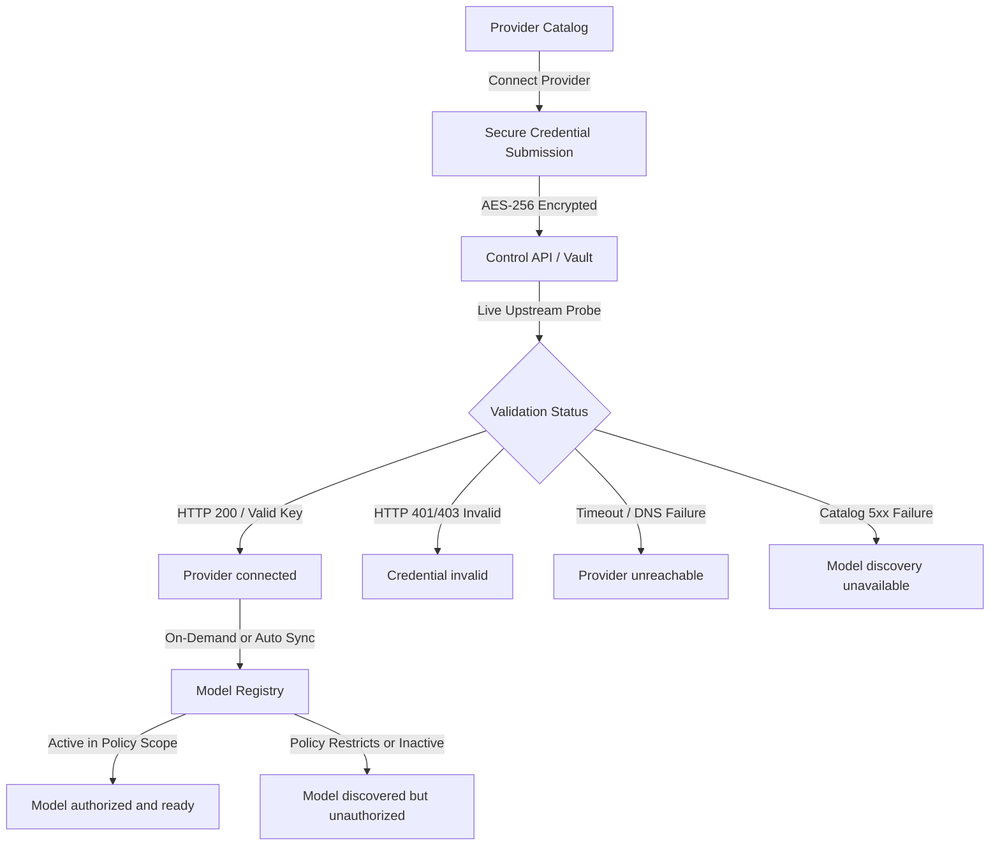
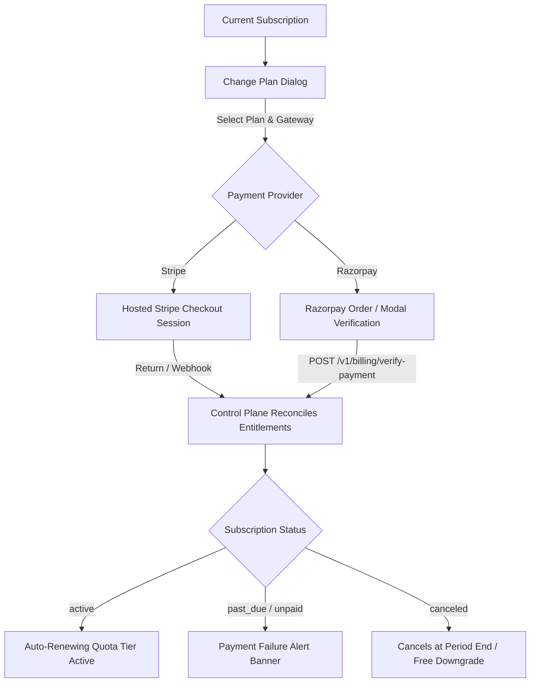

# Frontend Provider and Billing Management

Sentinel extends its dashboard to manage upstream AI foundation providers and organizational subscription billing without fragmenting operator workflows into separate tools.

---

## 1. Provider Management Architecture

### Supported Provider Catalog
1. **Anthropic**: Claude 3.7 Sonnet, Claude 3.5 Haiku, Claude 3 Opus (Thinking/Reasoning, Streaming, Tools, Caching).
2. **OpenAI**: GPT-4o, o1, o3-mini, GPT-4o-mini (Reasoning Effort, Structured Outputs, Multimodal, Streaming).
3. **Google Gemini**: Gemini 2.5 Pro, Flash, Thinking, Flash-Lite (Multimodal, System Instructions, Thinking Mode).
4. **Hugging Face**: DeepSeek-R1, Qwen 2.5, Llama 3.3, Mistral (Serverless Inference Providers, Custom Endpoints).
5. **Azure OpenAI**: Dedicated deployment endpoints with private VNets.
6. **Custom Providers**: OpenAI-compatible local/self-hosted runners (vLLM, Ollama, LocalAI, TGI).

### Secure Credential Submission
- Passwords and secret keys are submitted exclusively via masked input fields (`type="password"`) with visibility toggles.
- Secrets are encrypted with AES-256 before persistence in Postgres / Vault and are never returned in plaintext or logged.
- Live connectivity probes are executed in-flight to verify credentials prior to completing connection registration.

### Connection Validation States

| Status Badge | Tone | Meaning & Operator Guidance |
| :--- | :--- | :--- |
| `Provider connected` | Success (Green) | Upstream connection verified and healthy; models are accessible for gateway inference. |
| `Credential invalid` | Danger (Red) | Upstream provider rejected authentication (HTTP 401/403). The operator must rotate the credential. |
| `Provider unreachable` | Danger (Amber) | Upstream endpoint timed out or failed DNS resolution. Gateway will attempt fallback if configured. |
| `Model discovery unavailable` | Warning (Amber) | Stored credentials are valid, but upstream model catalog query failed. Stale catalog preserved. |
| `Disabled` | Neutral (Gray) | Connection is paused by administrator. Gateway denies inference routing targeting this account. |

### Model Capabilities & Authorization Statuses

Each discovered model displays:
- **Capabilities**: Streaming, Tool Calling, Reasoning / Thinking, Multimodal.
- **Context Limit**: Token context window (e.g. 128k, 200k, 1M).
- **Authorization Status**:
  - `Model authorized and ready`: Model discovered and permitted by Sentinel's governance policies.
  - `Model discovered but unauthorized`: Model present in provider catalog but blocked by organization model-access policies or gateway credential scope.

### Usage & Cost Analytics
Each provider account displays live 30-day telemetry:
- **Total Requests**: Metered proxy inference calls routed to this account.
- **Total Tokens**: Aggregate prompt and completion tokens.
- **Expenditure (USD)**: Real-time priced consumption calculated by Sentinel's async rating worker.

---

## 2. Billing Management Architecture

### Core Views & Controls

1. **Plan Catalog & Gateway Selection**:
   - Compares Free, Pro, and Enterprise tiers.
   - Dual-gateway selector: Operators choose **Stripe** or **Razorpay** for subscription checkout.
2. **Checkout Lifecycle & Banners**:
   - `?success=true`: Confirms checkout completion and verified subscription upgrade.
   - `?cancelled=true`: Informs the operator that the session was cancelled without mutating billing state.
   - `?error=...`: Renders payment verification errors.
3. **Payment Failure Messages**:
   - When a subscription transitions to `past_due` or `unpaid`, a persistent warning banner alerts administrators:
     > **Action Required: Subscription Payment Failed**
     > Your recent subscription renewal payment could not be settled. Please update payment details or re-run checkout to avoid request quota suspension.
4. **Quota Consumption & Limits Meter**:
   - Displays real-time consumed requests against the tier limit:
     - **Free**: 10,000 monthly requests
     - **Pro**: 1,000,000 monthly requests
     - **Enterprise**: 100,000,000 monthly requests
   - Dynamic progress bar color-codes consumption: Primary (<75%), Warning (75-90%), Danger (>90%).
5. **Invoices & Payment Statements**:
   - Itemized statement lines per billing period.
   - Distinct `paid` status tone (Success Green) displaying the upstream processor (`STRIPE` / `RAZORPAY`) and payment reference ID.

---

## 3. Production Verification Guarantee

All statuses, models, credentials, and usage data rendered in these views bind strictly to active backend control plane endpoints (`/v1/provider-accounts`, `/v1/providers/health`, `/v1/models`, `/v1/usage`, `/v1/billing`). No synthetic or mock states are rendered in production mode.
