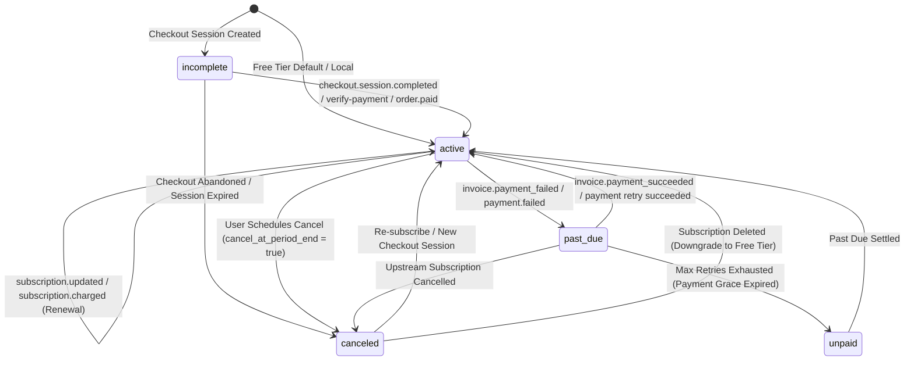
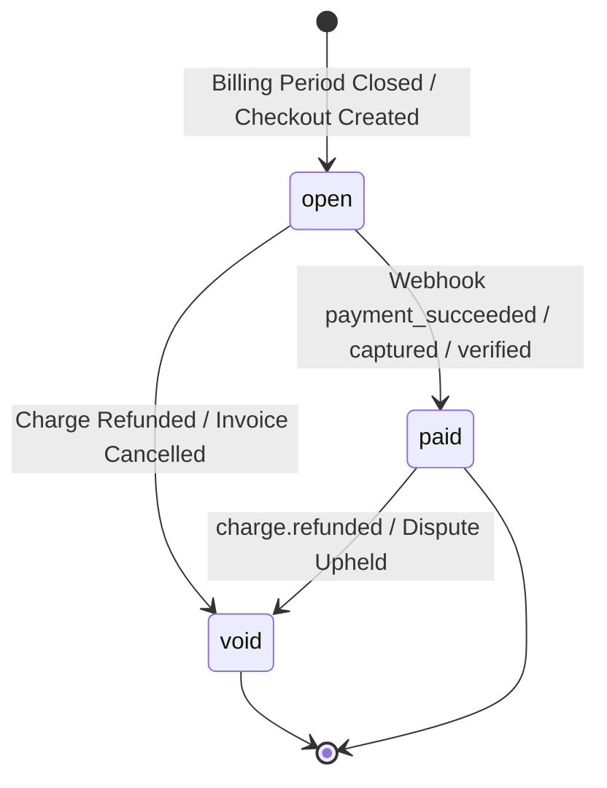

# Sentinel Billing State Machine & Entitlements

Sentinel maintains a centralized billing domain in [`backend/internal/domain/billing.go`](file:///home/sanju/ai-project/ai_gateway/backend/internal/domain/billing.go) and [`backend/internal/application/billing/service.go`](file:///home/sanju/ai-project/ai_gateway/backend/internal/application/billing/service.go). This document formalizes the subscription state machine, invoice lifecycle, idempotent webhook deduplication, and entitlement reconciliation rules.

---

## 1. Subscription State Machine



### State Definitions

| Subscription Status | Description | Gateway Entitlements Active? |
| :--- | :--- | :--- |
| `active` | In good standing. Current period active. | Yes (Full plan tier entitlements) |
| `trialing` | Active trial period. | Yes (Full plan tier entitlements) |
| `past_due` | Latest renewal charge failed. In temporary grace period. | Yes (Warning status communicated to user) |
| `unpaid` | Grace period expired after repeated payment failures. | Restrictive (Downgraded to Free limits) |
| `canceled` | Subscription cancelled. If within period, active until end. | Yes until `current_period_end`; then Free tier |
| `incomplete` | Initial payment authorization pending. | No (Retains prior plan entitlements) |

---

## 2. Invoice Lifecycle



### Invoice Fields & Rules

- **`status`**: `"open"`, `"paid"`, or `"void"`.
- **`payment_id`**: Upstream payment reference (e.g. `ch_...`, `py_...`, `pay_...`).
- **`paid_at`**: UTC timestamp when payment confirmation was cryptographically verified.
- **`payment_provider`**: Gateway used (`"stripe"` or `"razorpay"`).

---

## 3. Plan Entitlement Matrix & Enforcement

When plan transitions occur (via verified checkout, webhook update, or cancellation), Sentinel's billing service updates the organization's plan and enforces the corresponding capabilities:

| Entitlement Capability | Free Tier (`free`) | Pro Tier (`pro`) | Enterprise Tier (`enterprise`) |
| :--- | :--- | :--- | :--- |
| **Monthly Request Quota** | 10,000 | 1,000,000 | 100,000,000 (Custom) |
| **Upstream Provider Accounts** | 1 Account | Unlimited Multi-Provider | Unlimited Multi-Provider |
| **Fallback Routing** | Disabled | Enabled across active providers | Enabled across active providers |
| **Audit Log Retention** | 7 days | 30 days | 365 days compliance |
| **Privacy Mode** | Basic | Standard Guardrails | Full Content & Metadata Redaction |
| **Support SLA** | Community | Standard Email | 24/7 Dedicated Slack + 99.99% SLA |

### Automatic Downgrade on Cancellation
When an upstream subscription is deleted or terminated:
```go
// Reset to Free tier so organization retains baseline governance access
sub.PlanCode = domain.PlanCodeFree
sub.Status = domain.SubscriptionStatusActive
sub.PaymentProvider = "local"
sub.CancelAtPeriodEnd = false
```
The organization is never deleted or locked out; its request quota gracefully steps down from 1,000,000 to 10,000 requests.

---

## 4. Idempotency & Out-of-Order Delivery Protection

### 1. Database Deduplication
All incoming webhook deliveries are recorded in the `billing_events` table:
```sql
CREATE TABLE billing_events (
    id UUID PRIMARY KEY,
    organization_id UUID NOT NULL,
    provider TEXT NOT NULL,
    billing_event_id TEXT NOT NULL,
    event_type TEXT NOT NULL,
    payload JSONB NOT NULL,
    processed_at TIMESTAMPTZ NOT NULL,
    CONSTRAINT uq_billing_events_org_event UNIQUE (organization_id, billing_event_id)
);
```
- If a webhook retry arrives with an identical `billing_event_id`, the repository returns `ErrAlreadyExists`.
- Sentinel immediately responds with HTTP 200 without executing duplicate mutations or logging duplicate audit trails.

### 2. Out-of-Order Handling
- Webhook payloads include period start/end timestamps.
- If a late webhook arrives from an older period, the subscription state will not regress forward-moving expiration boundaries.
