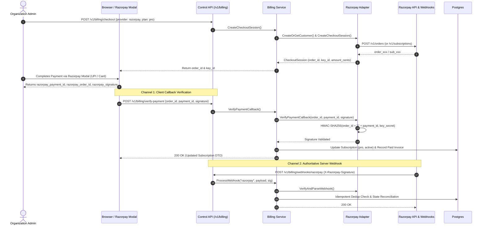

# Razorpay Payment Integration

Sentinel integrates Razorpay via the `PaymentGateway` adapter pattern located in [`backend/internal/infrastructure/payment/razorpay`](file:///home/sanju/ai-project/ai_gateway/backend/internal/infrastructure/payment/razorpay). Razorpay enables Sentinel organizations to settle recurring subscriptions and invoice orders using regional currencies (e.g. INR) and payment methods (UPI, Cards, Netbanking).

---

## 1. Architecture & Dual-Verification Workflow

Unlike redirect-only gateways, Razorpay frequently utilizes client-side modal checkout (`Razorpay Standard Checkout`). To guarantee security, Sentinel enforces **Dual-Channel Verification**:
1. **Synchronous Client Callback Verification (`POST /v1/billing/verify-payment`)**: Validates the cryptographic payment signature generated by Razorpay before confirming the plan upgrade to the user.
2. **Asynchronous Webhook Processing (`POST /v1/billing/webhooks/razorpay`)**: Ingests authoritative lifecycle notifications directly from Razorpay's servers.



---

## 2. Customer & Order Provisioning

- **Customer Identity**: Sent to `POST https://api.razorpay.com/v1/customers` with `notes.organization_id`. The returned `cust_...` identifier is saved as `subscriptions.provider_customer_id`.
- **Checkout Session**: Creates an upstream Razorpay order:
  ```json
  POST https://api.razorpay.com/v1/orders
  {
    "amount": 490000,
    "currency": "INR",
    "receipt": "rcpt_000000000001_1712345678",
    "notes": {
      "organization_id": "00000000-0000-0000-0000-000000000001",
      "plan_code": "pro"
    }
  }
  ```

---

## 3. Cryptographic Signature Verification

Sentinel rejects any client or webhook assertions that fail cryptographic verification.

### A. Client Callback Verification (`VerifyPaymentCallback`)
When Razorpay modal checkout completes, the frontend receives `razorpay_order_id`, `razorpay_payment_id`, and `razorpay_signature`.

The server verifies:
```go
// For standard order payments:
payload := orderID + "|" + paymentID
expectedSignature := hex(hmac_sha256(payload, razorpay_key_secret))

// Or for recurring subscription payments:
payload := paymentID + "|" + subscriptionID
expectedSignature := hex(hmac_sha256(payload, razorpay_key_secret))
```
Evaluation uses constant-time comparison. If invalid, returns HTTP 400 (`payment.ErrInvalidSignature`).

### B. Webhook Signature Verification (`VerifyAndParseWebhook`)
Razorpay delivers webhooks with the `X-Razorpay-Signature` header:
```go
mac := hmac.New(sha256.New(), []byte(webhookSecret))
mac.Write(rawBody)
expectedSignature := hex.EncodeToString(mac.Sum(nil))
```
If the header does not match `expectedSignature`, Sentinel returns HTTP 400 Bad Request immediately.

---

## 4. Supported Lifecycle Events

| Razorpay Event | Sentinel Action | Domain State Transition |
| :--- | :--- | :--- |
| `order.paid` | Confirms order settlement. | Creates or updates invoice with `status = "paid"`, records `payment_id`. |
| `payment.captured` | Payment captured and settled. | Marks subscription active; persists invoice with `status = "paid"`. |
| `subscription.activated` | Recurring mandate approved. | Sets `subscriptions.status = "active"`, associates `provider_subscription_id`. |
| `subscription.charged` | Recurring renewal payment successful. | Advances billing cycle period, creates paid invoice. |
| `subscription.cancelled` | Subscription mandate cancelled upstream. | Reverts organization to `free` tier (`status = "active"`, quota = 10,000). |
| `payment.failed` | Transaction declined or dropped. | Marks subscription `past_due`, records audit failure event. |

---

## 5. Security Principles

1. **Deterministic Event IDs**: For Razorpay webhooks that omit top-level event IDs, Sentinel computes a deterministic deduplication key `rzp_evt_<sha256(payload)>` preventing re-entrant double updates.
2. **Zero Storage of Payment Credentials**: Sentinel never touches UPI PINs, card CVVs, or OTPs. All sensitive authentication executes inside the Razorpay secure checkout frame.
