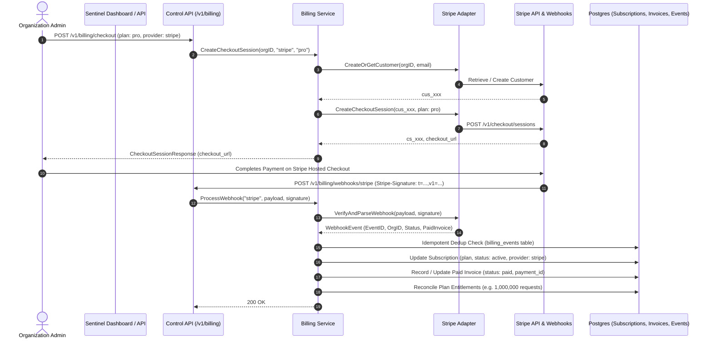

# Stripe Payment Integration

Sentinel integrates Stripe into its unified billing architecture via the `PaymentGateway` adapter pattern located in [`backend/internal/infrastructure/payment/stripe`](file:///home/sanju/ai-project/ai_gateway/backend/internal/infrastructure/payment/stripe). This design ensures that all customer records, checkout sessions, and webhook lifecycle events feed into Sentinel's core domain without leaking processor-specific models into business logic.

---

## 1. Architecture Overview



---

## 2. Customer Identity & Mapping

Stripe customers are lazily created and bound to Sentinel organizations:
1. When checkout is initiated, Sentinel queries or generates a Stripe Customer ID (`cus_...`) with metadata `organization_id: <uuid>`.
2. The `provider_customer_id` is persisted on the organization's subscription record in Postgres (`subscriptions.provider_customer_id`).
3. Subsequent checkouts, billing updates, and portal sessions reuse this customer record to prevent duplicate profiles.

---

## 3. Subscription Checkout Flow

- **Endpoint**: `POST /v1/billing/checkout`
- **Request Body**:
  ```json
  {
    "payment_provider": "stripe",
    "plan_code": "pro",
    "customer_email": "admin@example.com",
    "success_url": "https://sentinel.internal/app/billing/subscription?success=true",
    "cancel_url": "https://sentinel.internal/app/billing/subscription?cancelled=true"
  }
  ```
- **Response Body**:
  ```json
  {
    "session_id": "cs_test_1234567890",
    "payment_provider": "stripe",
    "checkout_url": "https://checkout.stripe.com/c/pay/cs_test_1234567890",
    "publishable_key": "pk_test_...",
    "amount_cents": 4900,
    "currency": "usd",
    "plan_code": "pro",
    "metadata": {
      "organization_id": "00000000-0000-0000-0000-000000000001",
      "plan_code": "pro"
    }
  }
  ```

---

## 4. Webhook Lifecycle & Signature Verification

Stripe sends asynchronous event notifications to `POST /v1/billing/webhooks/stripe`.

### Cryptographic Signature Verification
Each request includes the `Stripe-Signature` HTTP header in format:
```http
Stripe-Signature: t=1612345678,v1=abcdef0123456789...
```
1. Sentinel extracts timestamp `t` and signature hash `v1`.
2. Computes HMAC SHA-256 over `t + "." + payload` using `STRIPE_WEBHOOK_SECRET`.
3. Verifies against `v1` using constant-time comparison (`crypto/subtle.ConstantTimeCompare`).
4. Rejects requests with mismatched signatures or malformed headers with HTTP 400 Bad Request.

### Handled Webhook Events

| Stripe Event | Sentinel Action | Domain State Transition |
| :--- | :--- | :--- |
| `checkout.session.completed` | Validates session, extracts subscription ID (`sub_...`) and customer ID (`cus_...`). | Sets subscription `status = "active"`, sets `plan_code`, links provider customer & subscription IDs. |
| `customer.subscription.updated` | Parses status (`active`, `past_due`, `unpaid`, `trialing`, `canceled`). | Updates `subscriptions.status` and active period boundaries. |
| `customer.subscription.deleted` | Downgrades organization subscription to `free` tier. | Status remains `active`, resets provider to `local`, resets request quota to 10,000. |
| `invoice.payment_succeeded` | Records payable invoice record. | Creates or updates invoice with `status = "paid"`, records `payment_id`, `paid_at`, and itemized line items. |
| `invoice.payment_failed` | Marks subscription at risk. | Sets `subscriptions.status = "past_due"`. Gateway policies notify organization admins. |
| `charge.refunded` | Records refund status on invoice. | Sets invoice `status = "void"`, records audit trail entry. |

---

## 5. Security & Idempotency Guarantees

1. **Idempotent Deduplication**: Every webhook carries an event ID (`evt_...`). The shared billing service records processed events in the `billing_events` table under unique constraint `(organization_id, billing_event_id)`. Duplicate webhook retries are acknowledged immediately with HTTP 200 without mutating records.
2. **Zero Card Storage**: Sentinel never accepts, transmits, or stores raw payment card numbers, CVVs, or bank account credentials. All payment data collection occurs inside Stripe's PCI DSS Level 1 hosted checkout pages.
