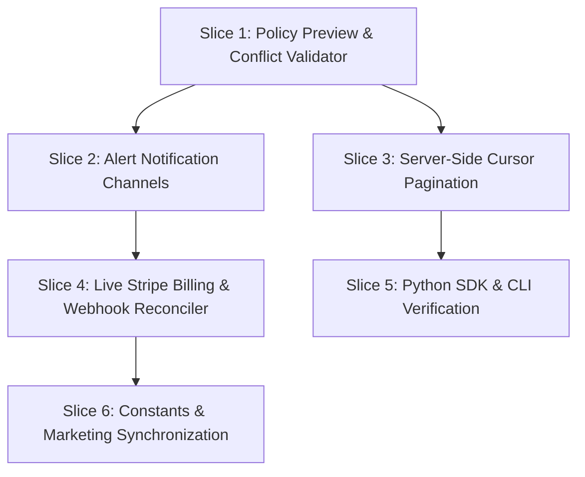

# Sentinel AI Gateway: Implementation Roadmap

**Date:** October 2026  
**Architect:** Sentinel Core Systems Architecture  
**Scope:** Dependency-ordered, risk-prioritized vertical slices to bridge remaining gaps identified in the [End-to-End Gap Analysis](file:///home/sanju/ai-project/ai_gateway/docs/implementation/end-to-end-gap-analysis.md).

---

## 1. Principles & Sequencing Strategy

1. **Dependency Invariance:** Lower-level core validation (data plane & control plane integrity) precedes async delivery, pagination, external billing integrations, and client SDK expansions.
2. **Risk-First Mitigation:** High-risk governance surfaces (policy evaluation preview, rule conflict validation) are tackled before non-blocking external notification channels and UI polish.
3. **Smallest Vertical Slices:** Every slice touches the full stack (DB/Domain -> Application Service -> HTTP Handler -> Frontend UI / Client) and includes automated tests so it can be verified and deployed independently.
4. **Zero Regression Guarantee:** Maintain byte-exact upstream proxy behavior, zero secret material leakage in API responses, and <1ms policy/credential cache invalidation.

---

## 2. Dependency Graph & Phase Sequencing

| Order | Vertical Slice | Risk Level | Primary Dependencies | Impact Area |
|---|---|---|---|---|
| **Slice 1** | Policy Preview & Rule Conflict Validator | **High** | Existing Policy Engine, Resolver | Govern / Policy Engine |
| **Slice 2** | Alert Notification Channels (Slack, SMTP) | **Medium** | Alert Evaluator, Worker Bus | Alerts / Incident Dispatch |
| **Slice 3** | Server-Side Cursor Pagination | **Medium** | PostgreSQL SQLC, DataTable UI | Audit Logs, Activity, Observability |
| **Slice 4** | Live Stripe Billing & Webhook Reconciler | **High** | In-DB Billing Ledger, SecretStore | Billing, Tier Enforcements |
| **Slice 5** | Python SDK & CLI Automated Verification | **Low** | Gateway v2 API, Control API | Developer Experience |
| **Slice 6** | Frontend Constants & Marketing Sync | **Low** | None | Landing Page, App Copy |

---

## 3. Detailed Vertical Slices

### Vertical Slice 1: Policy Preview & Rule Conflict Validation Engine
* **Objective:** Replace stubbed policy endpoints with real dry-run simulation and structural rule validation.
* **Problem Addressed:** 
  * [policies.go:281](file:///home/sanju/ai-project/ai_gateway/backend/internal/interfaces/controlapi/policies.go#L281) currently returns `{"status": "preview not implemented"}`.
  * [policies.go:286](file:///home/sanju/ai-project/ai_gateway/backend/internal/interfaces/controlapi/policies.go#L286) returns hardcoded `{"valid": true}` without validating rule syntax, model existence, or conflicting rule priority.
* **Dependencies:** [policy_resolver.go](file:///home/sanju/ai-project/ai_gateway/backend/internal/interfaces/gatewayv2/policy_resolver.go), [policy.Service](file:///home/sanju/ai-project/ai_gateway/backend/internal/application/policy/service.go).
* **Components & Files Touched:**
  1. `backend/internal/domain/policy/validator.go`: Add rule conflict detection (overlapping scopes, conflicting allow/deny actions).
  2. `backend/internal/application/policy/service.go`: Implement `PreviewPolicy(ctx, orgID, req)` executing dry-run evaluation through `policy_resolver`.
  3. `backend/internal/interfaces/controlapi/policies.go`: Wire `POST /v1/policies/preview` and `POST /v1/policies/{id}/validate`.
  4. `app/src/app/(dashboard)/app/govern/policies/[id]/page.tsx`: Connect Policy Editor UI "Test Policy / Dry Run" modal with live preview endpoint.
* **Testable Sub-Steps:**
  1. Unit test: `validator_test.go` covering overlapping model regex, priority collisions, and malformed JSON schemas.
  2. Integration test: `policies_preview_test.go` asserting correct allow/deny decision and rule attribution without modifying gateway state.
  3. UI verification: Policy editor highlights conflicting rules in real time.

---

### Vertical Slice 2: Alert Notification Delivery Engine (Slack & SMTP)
* **Objective:** Expand the alert incident dispatch system from generic webhooks to native Slack Webhook and SMTP email delivery.
* **Problem Addressed:** [evaluator.go:230](file:///home/sanju/ai-project/ai_gateway/backend/internal/application/alert/evaluator.go#L230) dispatches solely to raw webhooks, failing enterprise notification requirements.
* **Dependencies:** Worker background loop, [evaluator.go](file:///home/sanju/ai-project/ai_gateway/backend/internal/application/alert/evaluator.go), PostgreSQL table `alert_channels` ([00032_alerts_enhancement_and_history.sql](file:///home/sanju/ai-project/ai_gateway/backend/internal/infrastructure/postgres/migrations/00032_alerts_enhancement_and_history.sql)).
* **Components & Files Touched:**
  1. `backend/internal/infrastructure/notifications/slack.go`: Implement Slack Block Kit incident formatter and webhook transport with exponential backoff.
  2. `backend/internal/infrastructure/notifications/smtp.go`: Implement TLS SMTP client formatting HTML alert emails.
  3. `backend/internal/application/alert/dispatcher.go`: Multiplex outgoing incident alerts across configured destination types (`webhook`, `slack`, `email`).
  4. `app/src/app/(dashboard)/app/security/alerts/settings/page.tsx`: Add Slack Webhook URL and SMTP server configuration forms.
* **Testable Sub-Steps:**
  1. Unit test: Mock Slack server validating Block Kit JSON structure and HTTP 200 acknowledgment.
  2. Integration test: Trigger threshold breach in `evaluator_test.go` and assert dispatched event records in `alert_history`.
  3. Worker resilience: Verify channel timeouts (5s) do not block or crash the worker evaluator loop.

---

### Vertical Slice 3: Server-Side Cursor Pagination & UI Virtualization
* **Objective:** Enable efficient cursor-based pagination for high-volume append logs (`audit_logs`, `llm_requests`, `security_events`).
* **Problem Addressed:** 
  * [data-table.tsx](file:///home/sanju/ai-project/ai_gateway/app/src/components/dashboard/data-table.tsx#L40) performs client-side slicing over arrays returned in a single HTTP request.
  * Memory explosion occurs when audit records exceed 500 rows.
* **Dependencies:** SQLC queries in `backend/internal/infrastructure/postgres/queries/`, Control API handlers.
* **Components & Files Touched:**
  1. `backend/internal/infrastructure/postgres/queries/audit_logs.sql`: Add `ListAuditLogsCursor(org_id, before_id, limit)`.
  2. `backend/internal/interfaces/controlapi/audit_logs.go`: Add `next_cursor` / `has_more` response metadata.
  3. `backend/internal/interfaces/controlapi/activity.go`: Support `before_ts` / `cursor` for `/v1/activity`.
  4. `packages/api-client/src/index.ts`: Update client interfaces with pagination parameters.
  5. `app/src/components/dashboard/data-table.tsx`: Connect remote pagination buttons (Next/Previous Page) with URL query params `?cursor=...`.
* **Testable Sub-Steps:**
  1. Database test: Insert 2,000 synthetic audit records; assert deterministic retrieval order by ID DESC.
  2. API test: Step through consecutive cursors until `has_more: false`.
  3. UI test: Verify navigation between pages maintains active filter parameters without resetting state.

---

### Vertical Slice 4: Live Stripe Billing & Webhook Reconciler
* **Objective:** Connect the existing in-database billing tables with live Stripe Checkout sessions, customer portal, and incoming subscription webhooks.
* **Problem Addressed:** In-database ledger exists in [00010_billing.sql](file:///home/sanju/ai-project/ai_gateway/backend/internal/infrastructure/postgres/migrations/00010_billing.sql), but [billing.go](file:///home/sanju/ai-project/ai_gateway/backend/internal/interfaces/controlapi/billing.go) lacks Stripe webhook event processing.
* **Dependencies:** Stripe account configuration, `SecretStore` for Stripe secret keys, Control API.
* **Components & Files Touched:**
  1. `backend/internal/infrastructure/stripe/client.go`: Stripe Go SDK client wrapping checkout session creation and customer portal links.
  2. `backend/internal/interfaces/controlapi/webhooks_stripe.go`: Handler for `POST /v1/webhooks/stripe` with HMAC signature validation (`stripe-signature`).
  3. `backend/internal/application/billing/service.go`: Synchronize Stripe invoice, payment, and subscription status to `subscriptions` and `invoices` tables.
  4. `app/src/app/(dashboard)/app/platform/billing/billing-client.tsx`: Connect "Upgrade Plan" and "Manage Invoices" buttons to real Stripe checkout sessions.
* **Testable Sub-Steps:**
  1. Webhook validation test: Replay mocked Stripe events (`customer.subscription.updated`, `invoice.payment_succeeded`) and verify database ledger updates.
  2. Signature verification test: Assert invalid HMAC payloads fail with HTTP 400.
  3. Tenant isolation test: Verify subscription changes are strictly applied to the matching customer's `organization_id`.

---

### Vertical Slice 5: Sentinel Python SDK & CLI Automated Verification
* **Objective:** Supply native Python developer SDK (`sentinel-ai`) and add CI test automation for the Go CLI (`packages/cli`).
* **Problem Addressed:** Developers accessing Sentinel via Python frameworks (LangChain, LlamaIndex, OpenAI SDK) currently rely on raw HTTP requests or TypeScript packages.
* **Dependencies:** Gateway v2 OpenAPI spec, Control API contract.
* **Components & Files Touched:**
  1. `packages/python-sdk/sentinel_ai/`: Modern `httpx`-based synchronous and asynchronous client mimicking OpenAI/Anthropic gateway endpoints.
  2. `packages/python-sdk/pyproject.toml`: Poetry / hatch project definition.
  3. `packages/cli/cmd/cli_test.go`: Automated CLI integration test executing binary against local test server.
* **Testable Sub-Steps:**
  1. Python SDK test: Execute chat completion and streaming requests against local `gateway-v2` mock server.
  2. CLI test: Execute `aigw login`, `aigw config`, and `aigw request` inside Go sub-process test suite.

---

### Vertical Slice 6: Frontend Constants & Marketing Copy Synchronization
* **Objective:** Synchronize landing page and dashboard constants to reflect verified backend capabilities.
* **Problem Addressed:** 
  * [constants.ts:430](file:///home/sanju/ai-project/ai_gateway/app/src/lib/constants.ts#L430) and [landing-data.ts:193](file:///home/sanju/ai-project/ai_gateway/app/src/lib/landing-data.ts#L193) list retention policies and guardrails as "not implemented yet".
* **Dependencies:** None.
* **Components & Files Touched:**
  1. `app/src/lib/constants.ts`: Update feature descriptions to active/ready status.
  2. `app/src/lib/landing-data.ts`: Highlight real guardrail regex masking, automated data retention purging, and distributed rate limiting.
* **Testable Sub-Steps:**
  1. Static typecheck: `pnpm build` across `app/`.
  2. Visual inspection: Verify landing page features and documentation match real runtime state.

---

## 4. Implementation Schedule & Verification Gateways

| Milestone | Target Deliverables | Verification Gateway Command |
|---|---|---|
| **M1: Policy & Guardrails** | Slice 1 (Preview & Conflict Validator) | `cd backend && go test -v -race ./internal/application/policy/... ./internal/interfaces/controlapi/...` |
| **M2: Alerting & Resiliency** | Slice 2 (Slack/SMTP Dispatch) + Slice 3 (Pagination) | `cd backend && go test -v -race ./internal/application/alert/... ./internal/infrastructure/postgres/...` |
| **M3: Billing & Integrations** | Slice 4 (Stripe) + Slice 5 (Python SDK & CLI) | `pnpm --filter @ai-governance/api-client test && cd backend && go test -v ./internal/interfaces/controlapi/...` |
| **M4: Final Alignment** | Slice 6 (Constants Sync) & End-to-End Suite | `cd backend && go run ./cmd/e2e/main.go` |
