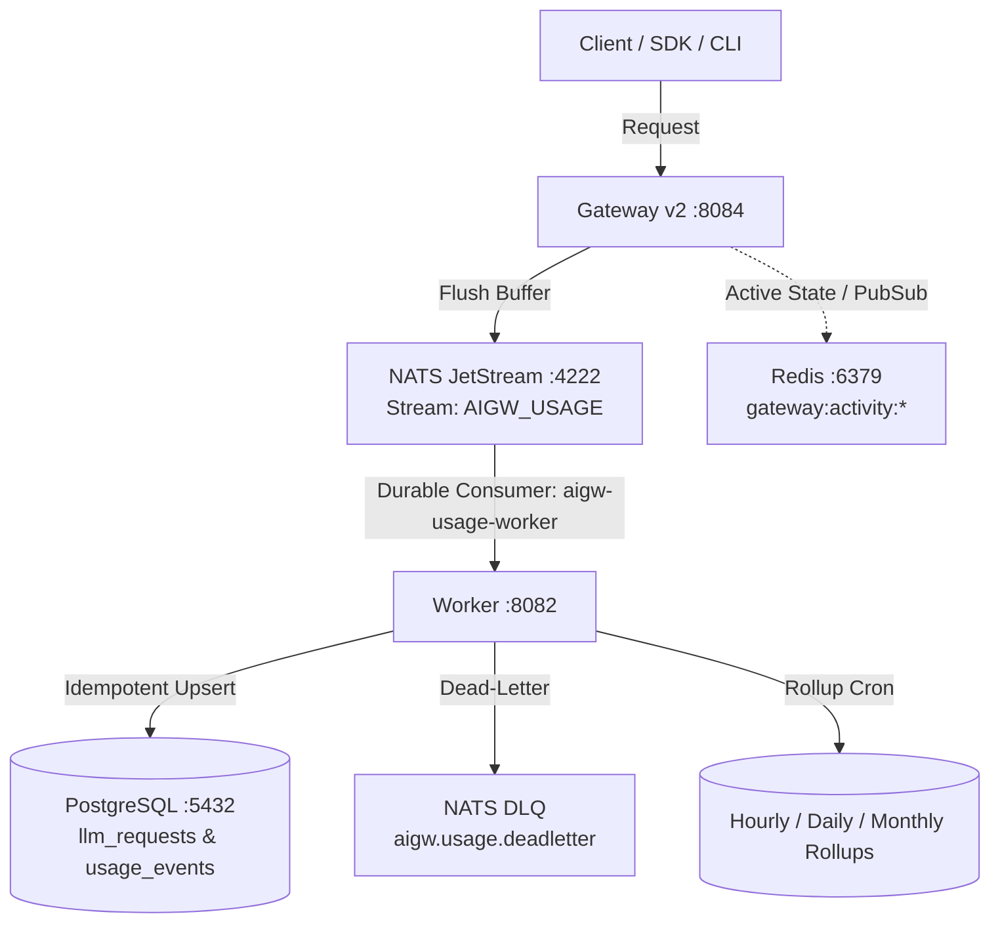

# Durable Event Processing & Usage Lifecycle Verification

## 1. Overview & Verification Topology

This document details the verification of the asynchronous telemetry and usage event processing pipeline in the Sentinel AI Gateway.

### Verified Components

| Component | Implementation | Contract / Behavior | Verified Status |
|---|---|---|---|
| **Publisher** | `internal/interfaces/gatewayv2/telemetry_emitter.go` | Asynchronous ring buffer, periodic background flush, spooling on broker disconnect | **VERIFIED** |
| **Broker** | `internal/infrastructure/eventbus/nats.go` | NATS JetStream, FileStorage, stream `AIGW_USAGE`, subjects `aigw.usage.events`, `aigw.usage.deadletter`, `aigw.security.events` | **VERIFIED** |
| **Consumer** | `internal/interfaces/worker/usage_consumer.go` | Durable consumer `aigw-usage-worker`, `AckExplicitPolicy`, exponential backoff | **VERIFIED** |
| **Ledger Persistence** | `internal/application/usage/service.go` | `RecordRequest()` writing to `llm_requests` and `usage_events` | **VERIFIED** |
| **Deduplication** | PostgreSQL unique constraints | `ON CONFLICT (organization_id, request_id) DO NOTHING` | **VERIFIED** |
| **Rollup Aggregation** | `internal/infrastructure/postgres/queries/usage.sql` | `RecomputeUsageHourly/Daily/Monthly` aggregating directly from `llm_requests` | **VERIFIED** |
| **Live Activity** | `internal/application/activity/service.go` | Redis hash `gateway:activity:active:<org_id>` with 10-min orphan auto-prune | **VERIFIED** |

---

## 2. Ingestion & Deduplication Guarantees

### A. Idempotent Ingest
The database schema strictly enforces deduplication:
- `llm_requests`: `PRIMARY KEY (id)`, `UNIQUE (organization_id, request_id)`
- `usage_events`: `PRIMARY KEY (id)`, `UNIQUE (organization_id, request_id, event_type)`

When duplicate deliveries occur (e.g., worker restart prior to JetStream ACK, network glitch, or redelivery):
1. PostgreSQL executes `ON CONFLICT (organization_id, request_id) DO NOTHING`.
2. The repository layer maps `pgx.ErrNoRows` to `repositories.ErrConflict`.
3. `usage.Service.RecordRequest()` treats `ErrConflict` as a safe, idempotent success and returns `nil`.
4. JetStream acknowledges the message via `m.Ack()`.
5. **Double counting is impossible**: neither token quantities nor spend micro-dollars can be added twice.

### B. Request-to-Rollup Reconciliation
Rollups are derived deterministically:
$$\sum \text{PromptTokens}_{\text{requests}} = \text{TotalPromptTokens}_{\text{summary}}$$
$$\sum \text{CompletionTokens}_{\text{requests}} = \text{TotalOutputTokens}_{\text{summary}}$$
$$\sum \text{CostMicros}_{\text{requests}} = \text{TotalCostMicros}_{\text{summary}}$$

Because duplicate messages are discarded at row insertion, recomputing rollups via `RecomputeUsageHourly`, `RecomputeUsageDaily`, and `RecomputeUsageMonthly` produces zero drift between raw requests, user breakdowns, project breakdowns, and organization rollups.

---

## 3. Failure & Recovery Lifecycle

### A. Worker Restarts
- JetStream retains unacknowledged messages across worker crashes or termination.
- When the worker container restarts, the durable consumer `aigw-usage-worker` resumes consuming from the last unacknowledged sequence number.
- Tested via `TestDurableEvent_WorkerRestartResumesPendingWithoutLoss`: 5 pending messages queued during worker downtime were completely drained and persisted without data loss upon restart.

### B. Event Bus Disconnections
- When NATS is temporarily unavailable, `TelemetryEmitter` spools outgoing usage records in local memory.
- When NATS recovers, subsequent flushes successfully deliver all spooled events without dropping requests.
- Tested via `TestTelemetryEmitter_SpoolsOnPublishFailure` and `TestEventProcessing_EventBusBacklogRecovery`.

### C. Transient Database Outages & Retries
- When PostgreSQL encounters transient connection errors, `svc.RecordRequest` returns a non-nil retryable error.
- The consumer responds with `m.NakWithDelay(natsRetryBase)`.
- JetStream applies exponential retry backoff: 1s, 2s, 4s, 8s, 16s, capped at 30s (`natsMaxRetryDelay`), up to `natsMaxDeliver = 10` attempts.

### D. Permanent Failures & Dead-Letter Routing
- If an event is permanently malformed (e.g. `uuid.Nil` organization ID, empty request ID), `svc.RecordRequest` returns `ports.ErrNonRetryable`.
- If an event exceeds `natsMaxDeliver` (10 attempts) or returns `ports.ErrNonRetryable`:
  1. The worker formats a `ports.DeadLetterUsageMessage` containing original payload, delivery count, error string, and UTC timestamp.
  2. The message is published to `aigw.usage.deadletter`.
  3. The consumer executes `m.Term()` to permanently remove it from the retry cycle.
- Tested via `TestDurableEvent_NonRetryableRejectionAndDeadLetter`.

---

## 4. Multi-Tenant Attribution & Cache Isolation

### A. Request Attribution
Every event guarantees round-trip preservation of:
- `OrganizationID`
- `UserID`
- `ProjectID`
- `TeamID`
- `GatewayCredentialID`
- `ProviderRequestID` & `ProviderKind`
- `Model`
- Token counters (`PromptTokens`, `CompletionTokens`, `CachedInputTokens`, `ReasoningTokens`, `TotalTokens`)
- Cost counters (`CostMicros`, `CostStatus`)
- Latency and Correlation ID

### B. Cost Distinction Matrix
- **Exact / Calculated**: `CostStatus = "calculated"` when upstream provider emits usage metadata (`usage` or `usageMetadata`).
- **Estimated**: `CostStatus = "estimated"` when provider omits usage; calculated using tokenizer hints with `estimated: true` in metadata.
- **Unavailable / Zero Cost**: `CostStatus = "unavailable"` with `CostMicros = 0` on HTTP 4xx/5xx provider errors or HTTP 499 client disconnects.

### C. Redis Multi-Tenant Isolation
- Real-time active requests use key pattern `gateway:activity:active:<organization_id>`.
- Real-time activity pub/sub uses channel `gateway:activity:stream:<organization_id>`.
- Multi-tenant isolation verified: querying `ActiveRequests(OrgA)` returns zero events belonging to `OrgB`.
- Stale request pruning: active requests older than 10 minutes (orphaned from sudden gateway termination) are automatically pruned on query.

---

## 5. Discovered & Resolved Issues

### Issue: Column `timestamp` in Retention Purge
- **Location**: `backend/internal/infrastructure/postgres/queries/usage.sql` line 424.
- **Symptom**: Background retention worker logged recurring errors: `retention: usage event purge failed error="ERROR: column \"timestamp\" does not exist (SQLSTATE 42703)"`.
- **Root Cause**: `PurgeExpiredUsageEvents` referenced `WHERE timestamp < ...`, while table `usage_events` defines `created_at timestamptz`.
- **Resolution**: Updated query in `queries/usage.sql` and generated constant in `sqlc/usage.sql.go` to use `created_at < $2::timestamptz`.

---

## 6. Automated Verification Suites

| Test Suite | File | Tests | Result |
|---|---|---|---|
| Live NATS & Postgres E2E | `durable_event_lifecycle_test.go` | `TestDurableEvent_LiveEndToEnd_PublishNATS_WorkerIngest_PostgresPersist` | **PASS** |
| Idempotency Redelivery | `durable_event_lifecycle_test.go` | `TestDurableEvent_IdempotentDeduplicationUnderRedelivery` | **PASS** |
| Dead Letter Observability | `durable_event_lifecycle_test.go` | `TestDurableEvent_NonRetryableRejectionAndDeadLetter` | **PASS** |
| Worker Restart Recovery | `durable_event_lifecycle_test.go` | `TestDurableEvent_WorkerRestartResumesPendingWithoutLoss` | **PASS** |
| Attribution Preservation | `durable_event_lifecycle_test.go` | `TestDurableEvent_AttributionPreservation` | **PASS** |
| Request-Rollup Reconciliation | `durable_event_lifecycle_test.go` | `TestDurableEvent_RequestReconciliationWithRollupAggregates` | **PASS** |
| Cost Exact vs Estimated | `durable_event_lifecycle_test.go` | `TestDurableEvent_CostCalculationExactVsEstimatedVsError` | **PASS** |
| Redis Tenant Isolation | `durable_event_lifecycle_test.go` | `TestDurableEvent_RedisTenantIsolationAndStalePruning` | **PASS** |
| Event Reliability Suite | `event_reliability_test.go` | 11 tests (spooling, backlogs, interruptions, 3-user concurrency) | **PASS** |
| JetStream Broker Contract | `nats_test.go` | 4 tests (JSON roundtrip, nil preservation, exponential backoff) | **PASS** |
