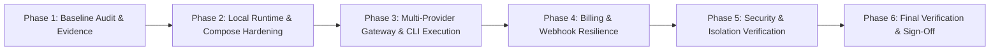

# Sentinel AI Gateway — Local Readiness Implementation Plan

**Date**: 2026-10-19  
**Status**: Active Execution Roadmap  
**Target**: Complete, Reliable, Secure Local Development Runtime (100% Local Readiness)

---

## 1. Roadmap Architecture & Objectives

The goal of this implementation plan is to make Sentinel AI Gateway a complete, reliable, secure, end-to-end functional application running locally—without rebuilding, over-simplifying into an MVP, or introducing unverified cloud infrastructure.

---

## 2. Milestone Work Breakdown

### Milestone 1: Baseline Audit & State Verification (Phase 1)
- **Objective**: Establish the true repository state through exhaustive code inspection and active test execution.
- **Affected Components**: All subsystems (`backend`, `app`, `packages/cli`, `packages/api-client`, `deploy/compose`).
- **Deliverables**:
  - [`docs/local-readiness/repository-audit.md`](file:///home/sanju/ai-project/ai_gateway/docs/local-readiness/repository-audit.md)
  - [`docs/local-readiness/implementation-plan.md`](file:///home/sanju/ai-project/ai_gateway/docs/local-readiness/implementation-plan.md)
  - [`docs/local-readiness/feature-verification-matrix.md`](file:///home/sanju/ai-project/ai_gateway/docs/local-readiness/feature-verification-matrix.md)
- **Completion Criteria**: Complete feature inventory documented with source paths, persistence, authorization, and test results.

### Milestone 2: Local Runtime & Container Infrastructure Hardening (Phase 2)
- **Objective**: Ensure that `docker-compose.yml`, local process supervisors, and development scripts operate reliably without secret leakage or network flakiness.
- **Affected Components**: [`deploy/compose/docker-compose.yml`](file:///home/sanju/ai-project/ai_gateway/deploy/compose/docker-compose.yml), [`scripts/dev-ctl.sh`](file:///home/sanju/ai-project/ai_gateway/scripts/dev-ctl.sh), [`scripts/verify-local.sh`](file:///home/sanju/ai-project/ai_gateway/scripts/verify-local.sh).
- **Key Tasks**:
  1. Validate synchronized Redis credentials (`AIGW_REDIS_PASSWORD` / `REDIS_PASSWORD`).
  2. Verify readiness probes (`/readyz`, `pg_isready`, `redis-cli ping`, NATS `/healthz`) in container and standalone modes.
  3. Ensure non-destructive initialization of `.env` files preserving existing developer overrides.
  4. Test local seed data script idempotency (`backend/cmd/seed/main.go`).
- **Verification Gate**: `bash scripts/dev-ctl.sh status` and `go run ./cmd/config-validate` pass with exit code 0.

### Milestone 3: Multi-Provider Gateway & CLI Execution Verification (Phase 3)
- **Objective**: Ensure all 4 upstream provider adapters and the Sentinel CLI operate deterministically with full request lifecycle fidelity.
- **Affected Components**: [`backend/internal/infrastructure/provider`](file:///home/sanju/ai-project/ai_gateway/backend/internal/infrastructure/provider), [`backend/internal/interfaces/gatewayv2`](file:///home/sanju/ai-project/ai_gateway/backend/internal/interfaces/gatewayv2), [`packages/cli`](file:///home/sanju/ai-project/ai_gateway/packages/cli).
- **Key Tasks**:
  1. Verify Gemini, OpenAI, Anthropic, and Hugging Face adapters handle streaming SSE, parameter mapping, and token extraction.
  2. Verify CLI dynamic slash-command menu filtering and execution (`/safety`, `/endpoint`, `/max-tokens`, `/clear`, `/compact`).
  3. Validate SSRF prevention on custom dedicated inference endpoints.
  4. Ensure telemetry publishing to NATS JetStream and worker consumption into `llm_requests`.
- **Verification Gate**: `go test -v ./... -run TestPhaseF_MultiProviderVerification` and `TestPhaseG_CLI_EndToEndScenario` pass with exit code 0.

### Milestone 4: Billing & Webhook Resilience Verification (Phase 4)
- **Objective**: Verify dual-gateway billing safety invariants, checkout session generation, and webhook idempotency.
- **Affected Components**: [`backend/internal/infrastructure/payment`](file:///home/sanju/ai-project/ai_gateway/backend/internal/infrastructure/payment), [`backend/internal/application/billing`](file:///home/sanju/ai-project/ai_gateway/backend/internal/application/billing), [`backend/internal/interfaces/controlapi/billing.go`](file:///home/sanju/ai-project/ai_gateway/backend/internal/interfaces/controlapi/billing.go).
- **Key Tasks**:
  1. Enforce explicit billing mode dispatch (`disabled`, `simulation`, `provider_test`).
  2. Verify Stripe and Razorpay cryptographic HMAC webhook signature verification.
  3. Verify webhook duplicate replay idempotency (`ON CONFLICT DO NOTHING`).
  4. Verify itemized invoice generation with token counts and micro-dollar cost calculations.
- **Verification Gate**: `go test -v ./internal/interfaces/controlapi -run "TestBilling.*"` passes with exit code 0.

### Milestone 5: Security, RBAC & Tenant Isolation Hardening (Phase 5)
- **Objective**: Assert complete cross-tenant and cross-user data isolation at API, database, cache, and CLI layers.
- **Affected Components**: [`backend/internal/infrastructure/postgres/migrations`](file:///home/sanju/ai-project/ai_gateway/backend/internal/infrastructure/postgres/migrations), [`backend/internal/application/identity`](file:///home/sanju/ai-project/ai_gateway/backend/internal/application/identity), [`backend/internal/application/conversation`](file:///home/sanju/ai-project/ai_gateway/backend/internal/application/conversation).
- **Key Tasks**:
  1. Verify PostgreSQL `FORCE ROW LEVEL SECURITY` across all tenant-owned tables.
  2. Verify that non-privileged members cannot read other users' credentials, billing usage, invoices, or conversation transcripts (`403 Forbidden`).
  3. Verify that credential revocation immediately blocks subsequent inference traffic (`401 Unauthorized`).
  4. Verify immutable append-only triggers on `audit_logs` and `security_events`.
- **Verification Gate**: `go test -v ./internal/interfaces/controlapi -run "TestPhaseG_ControlAPI.*"` passes with exit code 0.

### Milestone 6: Full Regression Battery & Sign-Off (Phase 6)
- **Objective**: Execute the complete verification battery across all languages and layers with zero regressions.
- **Commands**:
  1. Go formatting: `gofmt -l backend packages/cli`
  2. Static analysis: `go vet ./...` (backend & CLI)
  3. Architecture boundary check: `bash scripts/check-boundaries.sh`
  4. Race detection: `go test -race ./internal/...`
  5. Backend tests: `go test -count=1 ./...`
  6. CLI tests: `go test -count=1 ./...` in `packages/cli`
  7. SDK tests: `npm test` in `packages/api-client`
  8. Frontend lint & typecheck: `npm run lint && npm run typecheck` in `app`
  9. Frontend unit tests & build: `npm test && npm run build` in `app`
  10. Full release-readiness suite: `bash scripts/verify-local.sh`
- **Deliverable Sign-Off**: Final update to [`docs/local-readiness/final-test-report.md`](file:///home/sanju/ai-project/ai_gateway/docs/local-readiness/final-test-report.md) with an honest verdict.
